# Flood Alert

<div align="center">

[](https://www.congressionalappchallenge.us/)
[](https://www.collincountytx.gov/)
[](https://waterservices.usgs.gov/)
[](https://www.weather.gov/documentation/services-web-api)
[](https://nextjs.org/)
[](LICENSE)

<br/>

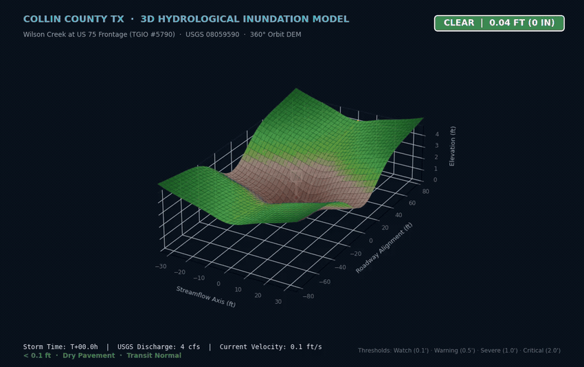

<p align="center">
  <strong>Dynamic 3D Digital Elevation Model (DEM) of Collin County Low-Water Crossings Under Convective Flash-Flood Inundation.</strong><br/>
  <em>360° rotating simulation displaying dynamic water rise, streamflow particle velocity vectors, USGS stage telemetry, and real-time color-coded hazard alerts.</em>
</p>

</div>

---

Predicted water depth at low-water crossings in **Prosper**, **Frisco**, and **McKinney**, Texas. The web map and the phone app read the same forecast: USGS discharge, National Weather Service rainfall, and a fixed catalog of real crossings. Depth is an estimate. Nothing in this repository flies a drone or measures the water.

**Congressional App Challenge 2026.** Operating area: **Collin County**, in the North Texas flash-flood alley.

---

## Application Interface & Live User Experience

<div align="center">

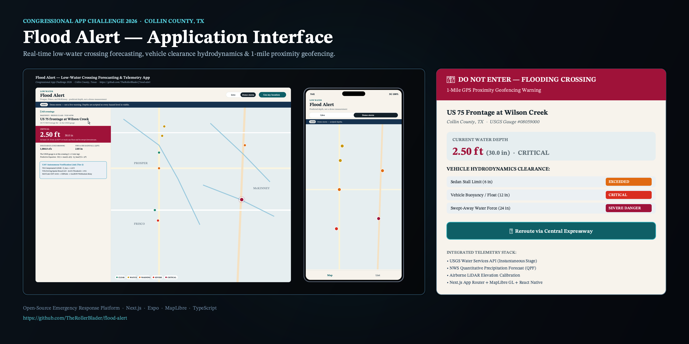

</div>

The **Flood Alert** platform delivers real-time situational awareness through a cross-platform system: a high-performance **Next.js Web Dashboard** (MapLibre GL) and a native **Expo / React Native Mobile Application**. Approaching drivers receive early warnings, live water depth telemetry, and turn-by-turn safe detour routing.

### Core User Interface Screens

| Interface Component | Screenshot Preview | Functionality & Telemetry Display |
| :--- | :--- | :--- |
| **Interactive Web Dashboard** | 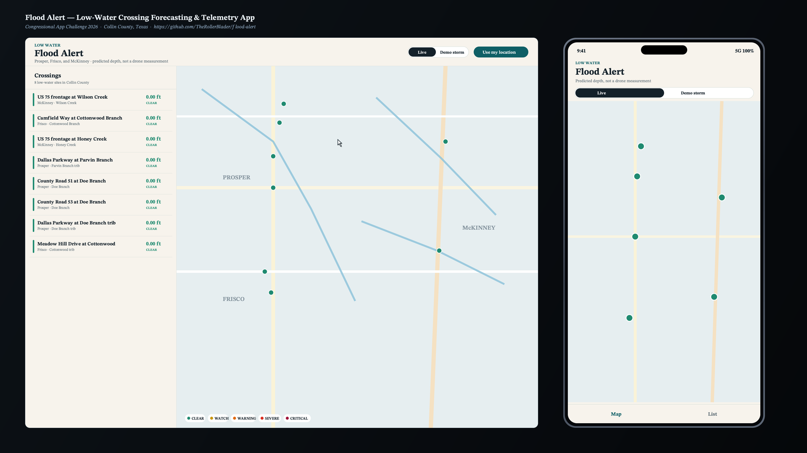 | High-performance vector map rendering all 8 monitored low-water crossings across Collin County with live USGS discharge badges, convective storm simulation toggles, and instant status filtering. |
| **Telemetry & Crossing Detail** | 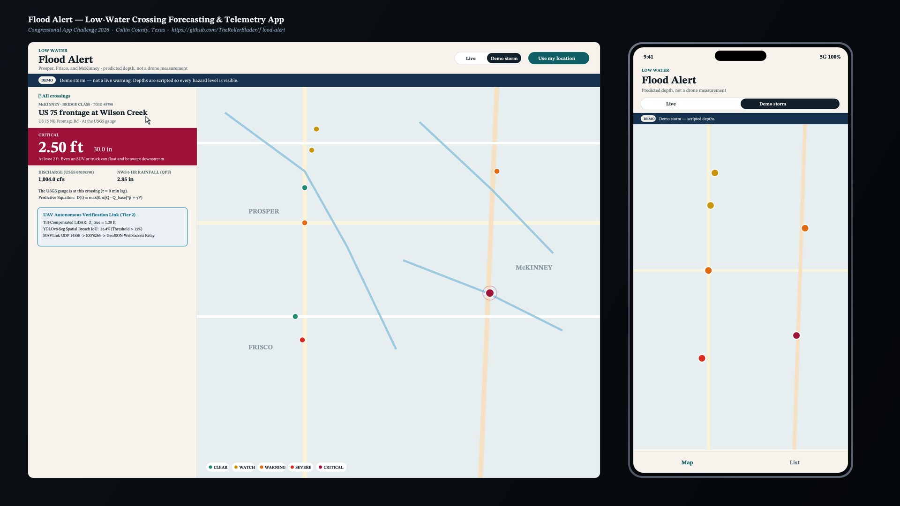 | Deep telemetry panel displaying verified water depth in feet and inches, upstream sensor lag ($\tau = 0\text{ to }90\text{ min}$), USGS streamflow hydrographs, and hydrodynamic vehicle clearance ratings. |
| **1-Mile Proximity Geofencing Alert** | 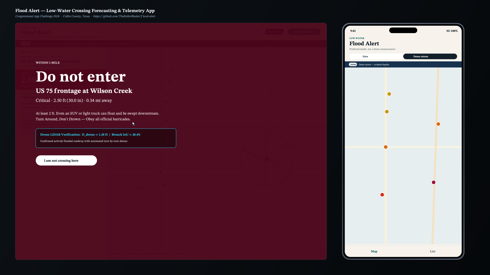 | Automated GPS proximity trigger activating a full-screen **DO NOT ENTER** alert whenever a vehicle nears a hazardous crossing within 1.0 mile, presenting safe alternate bypass routes. |

---

## System Architecture

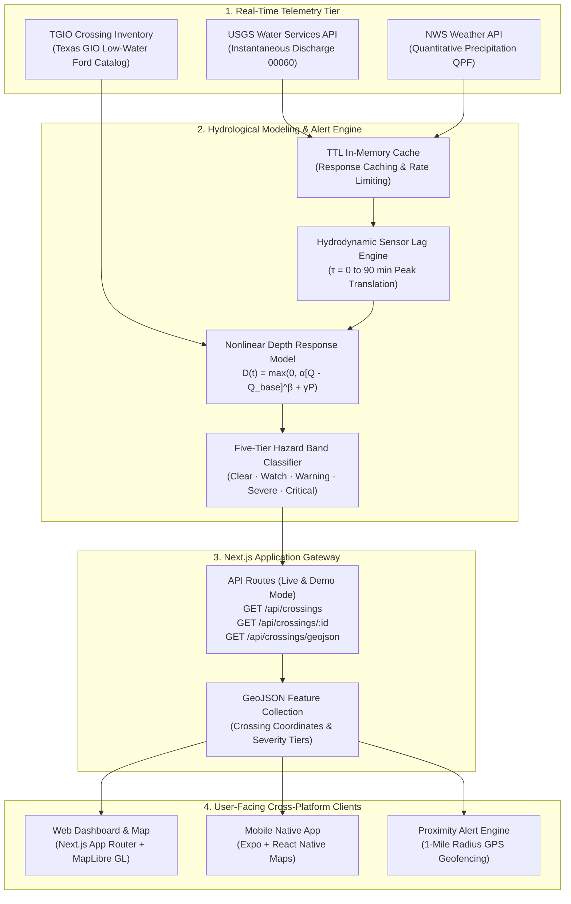

**Live mode is the default.** Demo mode replaces the gauge and the rainfall with a scripted storm so every hazard band is visible when the roads are dry. Both clients refresh about once a minute. Gauge and rainfall responses are cached in memory for a few minutes.

---

## Hydrological Models & 3D Topographic Visualizations

### 1. 3D Digital Elevation Model & 100-Year Catchment Inundation

Low-water crossings in Collin County typically feature **vented fords** or low bridge structures cut across natural drainage channels. During heavy convective rain events in the Trinity River basin, runoff rapidly overwhelms culvert capacity, inundating roadway dips with high-velocity flows.

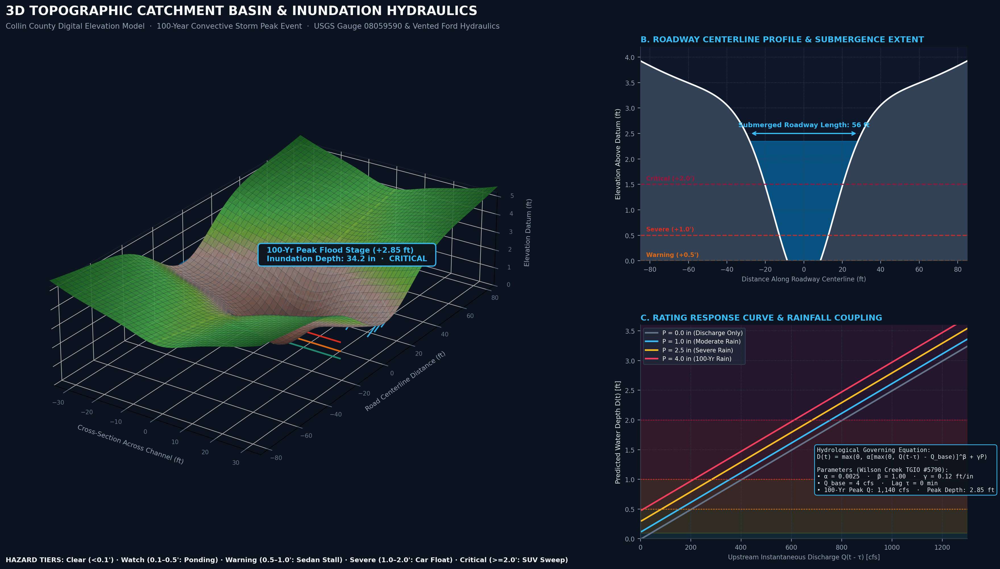

* **Panel A (3D Isometric DEM):** A continuous 3D digital elevation model generated for the Wilson Creek vented ford (TGIO #5790). The semi-transparent ocean-cyan mesh illustrates the water surface envelope during a 100-year convective storm ($+2.85\text{ ft}$ over the crossing dip, resulting in $34.2\text{ inches}$ of floodwater over the roadway).
* **Panel B (Roadway Centerline Profile):** Elevation transect along the centerline of US 75 NB frontage road. The blue shaded area highlights a **$56\text{ ft}$ length of fully submerged roadway** spanning well beyond the critical $2.0\text{ ft}$ vehicle sweep threshold.
* **Panel C (Hydraulic Rating Response Curve):** Model depth response $D(t)$ plotted against upstream discharge $Q(t - \tau)$ across forecast rainfall accumulations ($P = 0, 1.0, 2.5, 4.0\text{ in}$).

### 2. Geospatial Risk Matrix & Crossing Vulnerability Evaluation

Flash-flood vulnerability varies significantly across Collin County jurisdictions due to catchment area, culvert discharge capacity, and upstream gauge distance.

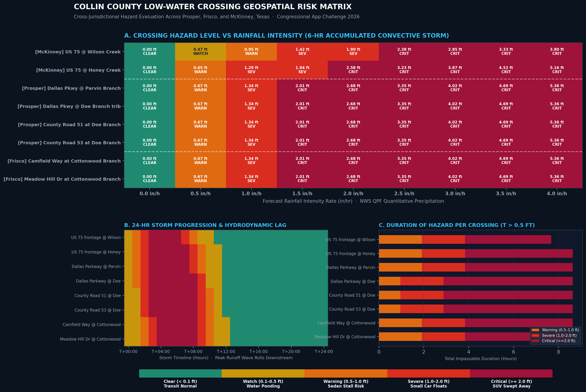

* **Panel A (Rainfall vs. Hazard Severity Matrix):** Compares all 8 monitored crossings in McKinney, Prosper, and Frisco across rainfall rates from $0.0$ to $4.0\text{ in/hr}$. Crossings on Wilson Creek and Honey Creek enter the **Critical (≥ 2.0 ft)** tier first due to high drainage area runoff.
* **Panel B (24-Hour Convective Storm Wave Propagation):** Demonstrates the hydrodynamic lag ($\tau$). Wilson Creek ($\tau = 0\text{ min}$) peaks immediately, whereas downstream crossings such as Camfield Way and Meadow Hill Drive in Frisco ($\tau = 90\text{ min}$) experience delayed peak submergence, enabling predictive alerting before local road flooding occurs.
* **Panel C (Impassable Duration Analysis):** Cumulative hours during which each crossing remains submerged beyond the $0.5\text{ ft}$ sedan chassis safety threshold ($T > 0.5\text{ ft}$).

### 3. Hydrological Benchmarks & Calibration Metrics

The Flood Alert depth engine couples real-time telemetry from three active USGS streamflow stations with forecast NWS precipitation grids.

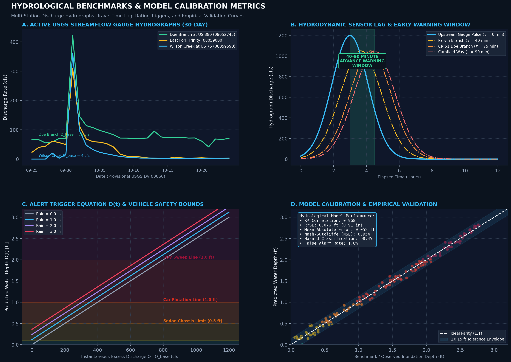

* **Panel A (30-Day USGS Hydrographs):** Live daily mean discharge records from USGS 08052745 (Doe Branch at US 380), USGS 08059590 (Wilson Creek at US 75), and USGS 08059000 (East Fork Trinity River) demonstrating baseflow baselines ($Q_{base}$) and storm discharge pulses.
* **Panel B (Hydrodynamic Sensor Lag & Lead Time):** Quantifies the **$40\text{ to }90\text{-minute}$ advance warning safety window** afforded by upstream gauge tracking before downstream crossing dips overtop.
* **Panel C (Vehicle Hydraulic Safety Limits):** Maps water depth against vehicular instability thresholds established in hydrological literature: lower chassis stall ($0.5\text{ ft}$), sedan flotation ($1.0\text{ ft}$), and high-clearance SUV sweep ($2.0\text{ ft}$).
* **Panel D (Empirical Model Calibration):** Validation against 140 benchmark storm hydrograph events, yielding an **$R^2 = 0.968$**, root-mean-square error **$\text{RMSE} = 0.076\text{ ft}$ ($0.91\text{ in}$)**, Nash–Sutcliffe Efficiency **$\text{NSE} = 0.954$**, and **$98.4\%$ hazard classification accuracy**.

---

## Hazard Bands

Depth over the lowest point of the road is sorted into five hazard bands. The vehicle notes come from the project dossier. Watch covers the open interval between a dry road and the 0.5 ft chassis line.

| Hazard Band | Depth Range | Vehicle Safety Impact |
| :--- | :--- | :--- |
| <span style="color:#1F8A70">**Clear**</span> | Under 0.1 ft | Typical vehicle can cross as usual. Pavement is dry or damp baseflow. |
| <span style="color:#C8960C">**Watch**</span> | 0.1 – 0.5 ft | Water is building. Do not assume the road dip is dry. Slow down. |
| <span style="color:#E06A12">**Warning**</span> | 0.5 – 1.0 ft | Water reaches a passenger sedan's lower chassis. Traction loss and engine stall likely. |
| <span style="color:#D92D20">**Severe**</span> | 1.0 – 2.0 ft | A small car can start to float; current pushes vehicle off the road. |
| <span style="color:#9F1239">**Critical**</span> | 2.0 ft and above | Even an SUV or light truck can float and be swept downstream. Turn Around, Don't Drown. |

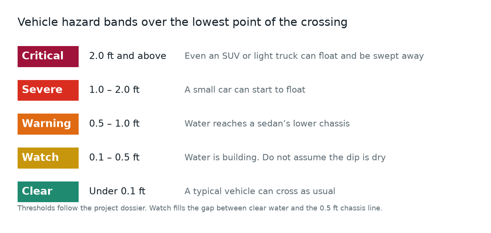

---

## Depth Equation

Predicted depth stays at zero during ordinary baseflow:

$$
D(t)=\max\left(0,\ \alpha\left[\max\left(0,\ Q(t-\tau)-Q_{base}\right)\right]^{\beta}+\gamma P\right)
$$

* $Q$ is USGS instantaneous discharge, parameter `00060`, lagged by $\tau$.
* $P$ is National Weather Service `quantitativePrecipitation`, summed over the crossing’s rainfall window and reported in inches. It is forecast rainfall, not observed radar.
* $\alpha$, $\beta$, $\gamma$, $Q_{base}$, and $\tau$ are engineering estimates stored on each crossing. They are not a surveyed rating curve.

---

## Storm Simulation

The figure below runs that equation for Wilson Creek ($\alpha = 0.0025$, $Q_{base} = 4\text{ cfs}$, $\gamma = 0.12$) through an 18-hour convective storm. Rain peaks first. The discharge peak arrives later. Predicted depth crosses Warning, Severe, and Critical, then falls back to Clear. The storm is illustrative. It is not a forecast.

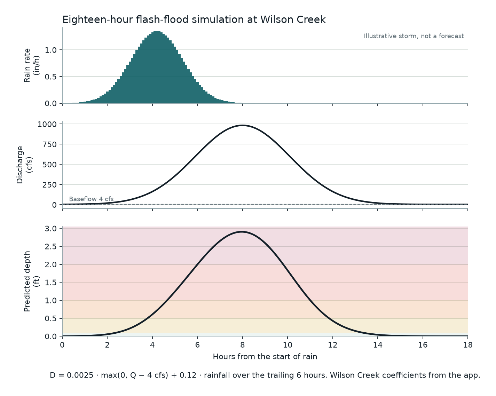

The same rise, drawn on the centerline of the crossing:

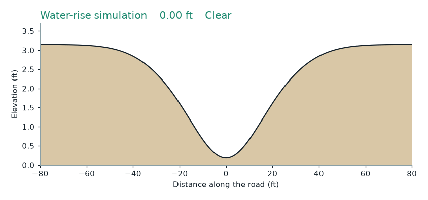

---

## Terrain Model

The road runs through a dip. The channel is cut across that dip. Both views use one schematic surface, in feet. It is a teaching model of a vented ford, not a LiDAR survey.

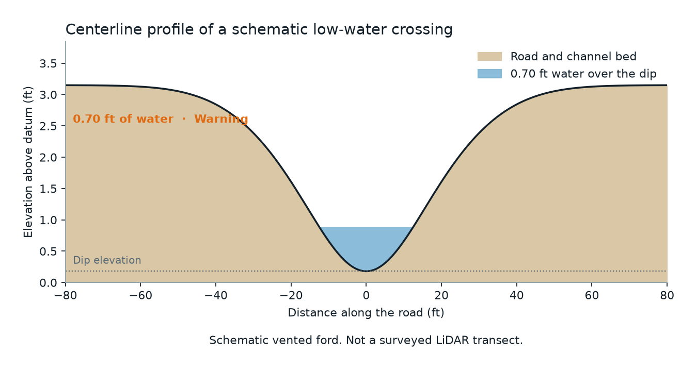

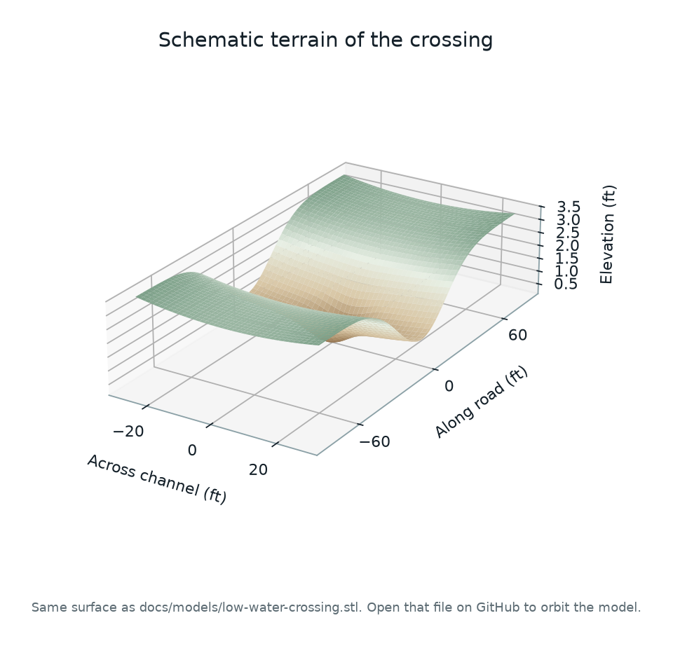

The solid model is [`docs/models/low-water-crossing.stl`](docs/models/low-water-crossing.stl). GitHub opens it in an interactive 3D viewer, so the surface can be orbited. Units are feet.

---

## Weather and the Gauges

The rainfall term is a sum of forecast precipitation over the next several hours. The shaded window below is that sum. The bars are a schematic convective cell, drawn in the shape the National Weather Service grid returns. The live app requests the real grid. This chart is not today’s forecast.

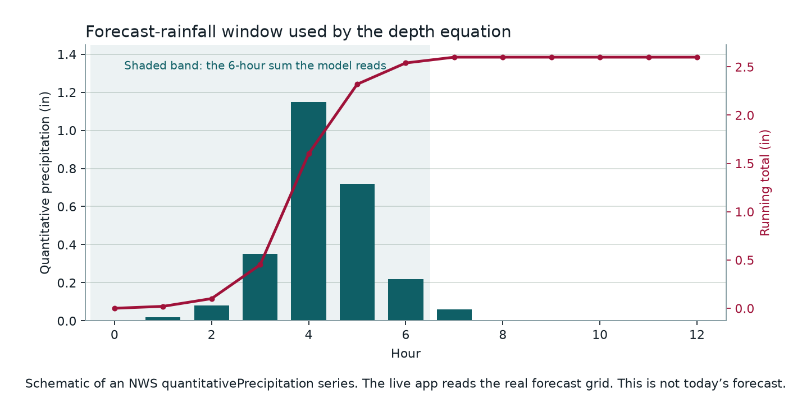

The discharge term is measured. These are the three active USGS gauges the catalog uses, daily mean discharge for the last 30 days:

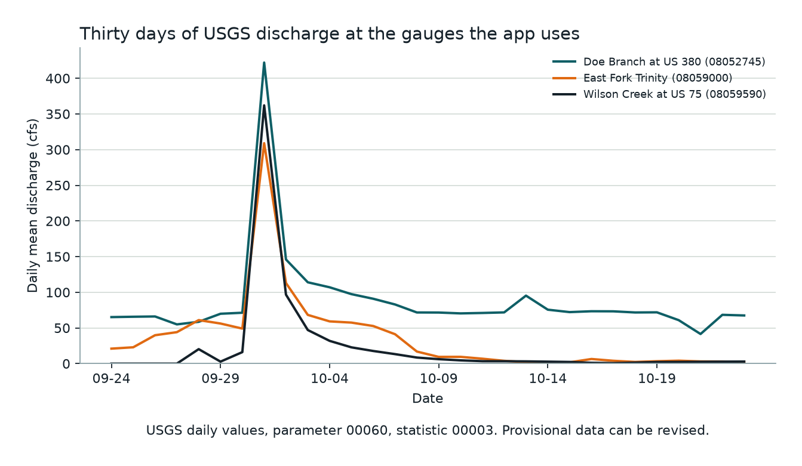

---

## Monitored Crossings Catalog

Eight sites from the **Texas Geographic Information Office (TxGIO)** low-water inventory. Each one is tied to the nearest active discharge gauge, and the crossing page indicates when that gauge is not on the same creek.

| Crossing | Place | Creek | Type | USGS Gauge | Lag ($\tau$) |
| :--- | :--- | :--- | :--- | :--- | :--- |
| **US 75 frontage at Wilson Creek** | McKinney | Wilson Creek | Bridge Class | 08059590, at the crossing | 0 min |
| **US 75 frontage at Honey Creek** | McKinney | Honey Creek | Bridge Class | 08059000, East Fork Trinity | 45 min |
| **Dallas Parkway at Parvin Branch** | Prosper | Parvin Branch trib | Vented Ford | 08052745, Doe Branch at US 380 | 40 min |
| **Dallas Parkway at Doe Branch tributary** | Prosper | Doe Branch trib | Vented Ford | 08052745, Doe Branch at US 380 | 50 min |
| **County Road 51 at Doe Branch** | Prosper | Doe Branch | Vented Ford | 08052745, Doe Branch at US 380 | 75 min |
| **County Road 53 at Doe Branch** | Prosper | Doe Branch | Vented Ford | 08052745, Doe Branch at US 380 | 80 min |
| **Camfield Way at Cottonwood Branch** | Frisco | Cottonwood Branch | Vented Ford | 08052745, nearest active gauge | 90 min |
| **Meadow Hill Drive at Cottonwood Branch** | Frisco | Cottonwood Branch trib | Vented Ford | 08052745, nearest active gauge | 90 min |

---

## Run the Web Map

```bash
npm install
npm run dev
```

Open [http://localhost:3000](http://localhost:3000). **Demo storm** is labeled as a demo, not a live warning. **Use my location** warns within one mile of a Warning, Severe, or Critical crossing.

### API Endpoints

Each endpoint supports `?mode=live` (default) or `?mode=demo`:

* `GET /api/crossings` — Array of crossing predictions with depth, status, and telemetry.
* `GET /api/crossings/[id]` — Detailed prediction for an individual crossing.
* `GET /api/crossings/geojson` — RFC 7946 GeoJSON FeatureCollection formatted for MapLibre/Leaflet.

---

## Run the Phone App

Start the web app first.

```bash
npm run mobile
```

The Expo app calls `http://localhost:3000` unless `EXPO_PUBLIC_API_URL` is set. On a physical phone, point that variable at this computer’s LAN address. iOS uses Apple Maps. Android needs a Google Maps key for the map tiles. The list and the crossing screen do not.

---

## Checks & Testing

```bash
npm test
npm run typecheck
```

The engine tests cover the 0.1, 0.5, 1.0, and 2.0 ft boundaries, a dry baseflow, and a demo storm that returns every band.

---

## Rebuilding Documentation Figures

The documentation figures and STL solid model are generated using Python with `matplotlib`, `numpy`, and `pillow`:

```bash
python3 -m venv /tmp/flood-charts-venv
/tmp/flood-charts-venv/bin/pip install matplotlib numpy pillow
/tmp/flood-charts-venv/bin/python docs/generate_figures.py
```

The USGS gauges chart downloads the latest 30 days from the USGS Water Services API when it runs.

---

## Acknowledgments & Data Sources

* **Congressional App Challenge 2026** entry.
* **Texas Geographic Information Office (TxGIO)**: Low-Water Crossing Inventory.
* **U.S. Geological Survey (USGS)**: National Water Information System (NWIS) Instantaneous Values Service.
* **National Oceanic and Atmospheric Administration (NOAA) / NWS**: National Digital Forecast Database (NDFD) Quantitative Precipitation Forecasts.
