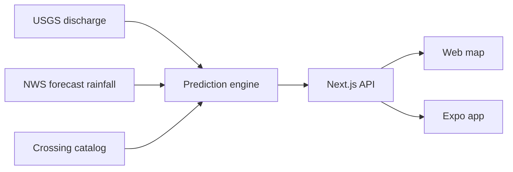

# Flood Alert

Predicted water depth at low-water crossings in Prosper, Frisco, and McKinney, Texas. The web map and the phone app read the same forecast: USGS discharge, National Weather Service rainfall, and a fixed catalog of real crossings. Depth is an estimate. Nothing in this repository flies a drone or measures the water.

Congressional App Challenge 2026. Operating area: Collin County, in the Texas flash-flood alley.

## Architecture



Live mode is the default. Demo mode replaces the gauge and the rainfall with a scripted storm so every hazard band is visible when the roads are dry. Both clients refresh about once a minute. Gauge and rainfall responses are cached in memory for a few minutes.

## Hazard bands

Depth over the lowest point of the road is sorted into five bands. The vehicle notes come from the project dossier. Watch covers the open interval between a dry road and the 0.5 ft chassis line.


## Depth equation

Predicted depth stays at zero during ordinary baseflow:

$$
D(t)=\max\left(0,\ \alpha\left[\max\left(0,\ Q(t-\tau)-Q_{base}\right)\right]^{\beta}+\gamma P\right)
$$

- \(Q\) is USGS instantaneous discharge, parameter `00060`, lagged by \(\tau\).
- \(P\) is National Weather Service `quantitativePrecipitation`, summed over the crossing’s rainfall window and reported in inches. It is forecast rainfall, not observed radar.
- \(\alpha\), \(\beta\), \(\gamma\), \(Q_{base}\), and \(\tau\) are engineering estimates stored on each crossing. They are not a surveyed rating curve.

## Storm simulation

The figure below runs that equation for Wilson Creek (\(\alpha = 0.0025\), \(Q_{base} = 4\) cfs, \(\gamma = 0.12\)) through an 18-hour convective storm. Rain peaks first. The discharge peak arrives later. Predicted depth crosses Warning, Severe, and Critical, then falls back to Clear. The storm is illustrative. It is not a forecast.


The same rise, drawn on the centerline of the crossing:


## Terrain

The road runs through a dip. The channel is cut across that dip. Both views use one schematic surface, in feet. It is a teaching model of a vented ford, not a LiDAR survey.


The solid model is [`docs/models/low-water-crossing.stl`](docs/models/low-water-crossing.stl). GitHub opens it in a viewer, so the surface can be orbited. Units are feet.

## Weather and the gauges

The rainfall term is a sum of forecast precipitation over the next several hours. The shaded window below is that sum. The bars are a schematic convective cell, drawn in the shape the National Weather Service grid returns. The live app requests the real grid. This chart is not today’s forecast.


The discharge term is measured. These are the three active USGS gauges the catalog uses, daily mean discharge for the last 30 days:


## Crossings

Eight sites from the Texas Geographic Information Office low-water inventory. Each one is tied to the nearest active discharge gauge, and the crossing page says when that gauge is not on the same creek.

| Crossing | Place | Gauge |
| --- | --- | --- |
| US 75 frontage at Wilson Creek | McKinney | 08059590, at the crossing |
| Dallas Parkway at Parvin Branch | Prosper | 08052745, Doe Branch at US 380 |
| County Road 51 at Doe Branch | Prosper | 08052745 |
| County Road 53 at Doe Branch | Prosper | 08052745 |
| Dallas Parkway at Doe Branch tributary | Prosper | 08052745 |
| Camfield Way at Cottonwood Branch | Frisco | 08052745, nearest active gauge |
| Meadow Hill Drive at Cottonwood Branch | Frisco | 08052745, nearest active gauge |
| US 75 frontage at Honey Creek | McKinney | 08059000, East Fork Trinity |

## Run the web map

```bash
npm install
npm run dev
```

Open http://localhost:3000. **Demo storm** is labeled as a demo, not a live warning. **Use my location** warns within one mile of a Warning, Severe, or Critical crossing.

API routes, each with `mode=live` or `mode=demo`:

- `GET /api/crossings`
- `GET /api/crossings/[id]`
- `GET /api/crossings/geojson`

## Run the phone app

Start the web app first.

```bash
npm run mobile
```

The Expo app calls `http://localhost:3000` unless `EXPO_PUBLIC_API_URL` is set. On a physical phone, point that variable at this computer’s LAN address. iOS uses Apple Maps. Android needs a Google Maps key for the map tiles. The list and the crossing screen do not.

## Checks

```bash
npm test
npm run typecheck
```

The engine tests cover the 0.1, 0.5, 1.0, and 2.0 ft boundaries, a dry baseflow, and a demo storm that returns every band.

## Rebuild the figures

The charts and the STL are generated by [`docs/generate_figures.py`](docs/generate_figures.py). It needs Python with `matplotlib`, `numpy`, and `pillow`.

```bash
python3 -m venv /tmp/flood-charts-venv
/tmp/flood-charts-venv/bin/pip install matplotlib numpy pillow
/tmp/flood-charts-venv/bin/python docs/generate_figures.py
```

The gauge chart downloads the latest 30 days from USGS when it runs.
