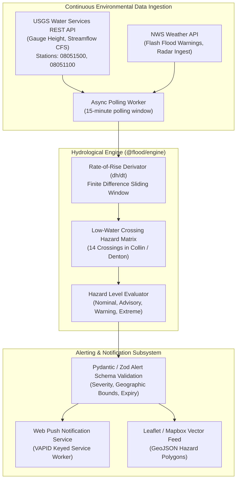

# Architecture Specification: North Texas Hydrology & Flood Alert Pipeline

## 1. Executive Summary
`flood-alert` is a real-time hydrological monitoring and early warning engine for low-water road crossings in Collin and Denton counties (Prosper, Frisco, McKinney). The system synthesizes instantaneous stream gauge data from the USGS National Water Dashboard, rainfall precipitation radar from the National Weather Service (NWS), and local elevation topography to forecast flash flooding hazards at critical road crossings.

---

## 2. System Architecture & Data Flow

---

## 3. Mathematical & Hydrological Foundations

### 3.1 Hydrograph Rate-of-Rise Derivation
Flash flooding at road crossings depends not merely on static gauge height $h(t)$, but on the instantaneous rate-of-rise $\frac{dh}{dt}$:
$$\frac{dh}{dt}(t) \approx \frac{h(t) - h(t - \Delta t)}{\Delta t}$$
Where $\Delta t$ is standard $15\text{ min}$ USGS reporting cadence. When $\frac{dh}{dt} \ge 1.5\text{ ft/hr}$, a preemptive flash-flood advisory is raised even if the nominal flood stage has not yet been breached.

### 3.2 Hazard Classification Matrix

| Gauge Stage ($h$) | Rate of Rise ($\frac{dh}{dt}$) | Assigned Severity | Action Required |
| :--- | :--- | :--- | :--- |
| $< h_{\text{action}}$ | $< 1.0\text{ ft/hr}$ | **Nominal** (Green) | Normal road passage. |
| $\ge h_{\text{action}}$ | $< 1.5\text{ ft/hr}$ | **Advisory** (Yellow) | Water ponding; low clearance vehicles alert. |
| $\ge h_{\text{flood}}$ | Any | **Warning** (Orange) | Water over roadway; automated barrier closing recommended. |
| $\ge h_{\text{major}}$ | $\ge 1.5\text{ ft/hr}$ | **Extreme** (Red) | Life-threatening flash flood; emergency dispatch notification. |

### 3.3 Monitored Watershed Crossings (North Texas)
The engine maintains strict coordinate and threshold bounds for 14 vulnerable crossings across:
* **East Fork Trinity River**: FM 543, CR 168 (McKinney).
* **Rowlett Creek**: US 380, Custer Rd (Frisco).
* **Wilson Creek**: Virginia Pkwy, Wilmeth Rd (Prosper / McKinney).

---

## 4. Verification & Testing Guardrails
* **Vitest Test Suite**: `packages/engine/src/alertSchema.test.ts`, `packages/engine/src/crossings.test.ts`, `packages/engine/src/usgs.test.ts`, `packages/engine/src/hydrographTrend.test.ts`.
* **Coverage**: 31 unit tests validating USGS API response parsing, rate-of-rise trend extrapolation, and schema serialization.
